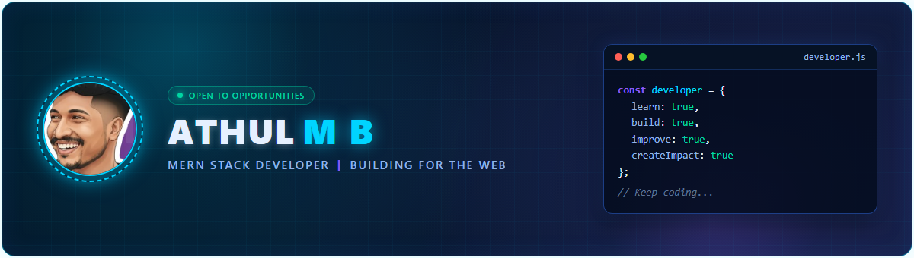
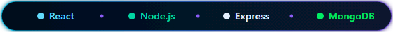
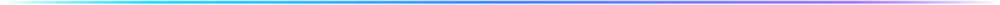
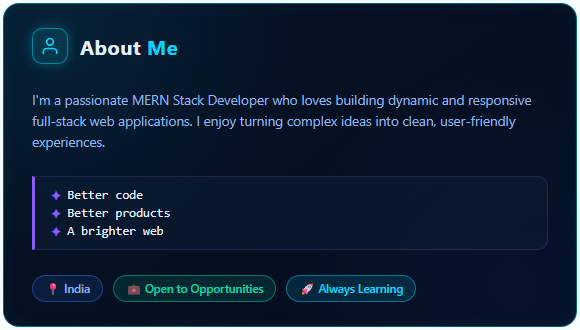
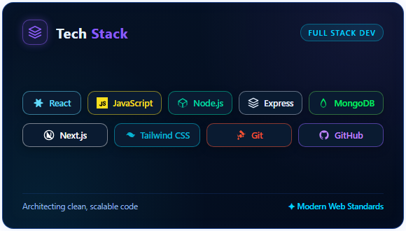
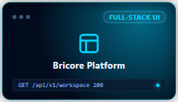
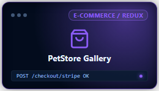
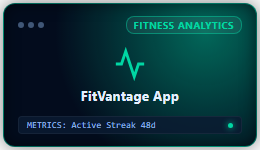

<!-- ==================== SECTION A: HERO BANNER ==================== -->

  

<!-- Centered Pill-Shaped Technology Line -->

  

<!-- Neon Gradient Divider -->

 

<!-- ==================== SECTION B: TWO-COLUMN ABOUT & TECH STACK ==================== -->
<table width="100%" border="0" cellspacing="0" cellpadding="0">
  <tr>
    <td width="50%" valign="top" align="center">
      
    </td>
    <td width="50%" valign="top" align="center">
      
    </td>
  </tr>
</table>

<!-- Accessible Text & Direct Documentation Links -->

  
<b>📖 View Text Version & Tech Stack Links (Click to Expand)</b>

   
  
  ### 👤 About Me
  > I'm a passionate **MERN Stack Developer** who loves building dynamic and responsive full-stack web applications. I enjoy turning complex ideas into clean, user-friendly experiences.
  >
  > *✦ Better code*  
  > *✦ Better products*  
  > *✦ A brighter web*  
  >
  > **Location:** 📍 India &nbsp;|&nbsp; **Status:** 💼 Open to Opportunities &nbsp;|&nbsp; **Mindset:** 🚀 Always Learning

  ---

  ### ⚡ Tech Stack & Tools
  - **Frontend:** [React](https://react.dev/) &nbsp;•&nbsp; [Next.js](https://nextjs.org/) &nbsp;•&nbsp; [Tailwind CSS](https://tailwindcss.com/) &nbsp;•&nbsp; [JavaScript (ES6+)](https://developer.mozilla.org/en-US/docs/Web/JavaScript)
  - **Backend:** [Node.js](https://nodejs.org/) &nbsp;•&nbsp; [Express.js](https://expressjs.com/)
  - **Database:** [MongoDB](https://www.mongodb.com/)
  - **Version Control & DevOps:** [Git](https://git-scm.com/) &nbsp;•&nbsp; [GitHub](https://github.com/)

 

  

 

<!-- ==================== SECTION C: GITHUB STATS DASHBOARD ==================== -->
<table width="100%" border="0" cellspacing="0" cellpadding="0">
  <thead>
    <tr>
      <th width="48%" align="left">
        <h3>&nbsp;&nbsp;⚡ GitHub Stats</h3>
      </th>
      <th width="52%" align="left">
        <h3>&nbsp;&nbsp;📈 Contribution Graph</h3>
      </th>
    </tr>
  </thead>
  <tbody>
    <tr>
      <!-- Left Side: Live Stats & Profile Metrics -->
      <td width="48%" valign="top" align="center">
        
          
        

          
          
          
        

      </td>
      <!-- Right Side: Live Activity Graph & Streaks -->
      <td width="52%" valign="top" align="center">
        
          
        
      </td>
    </tr>
  </tbody>
</table>

 

  

 

<!-- ==================== SECTION D: FEATURED PROJECTS ==================== -->
<table width="100%" border="0" cellspacing="0" cellpadding="0">
  <tr>
    <td align="left">
      <h2>🚀 Featured Projects</h2>
    </td>
    <td align="right">
      
    </td>
  </tr>
</table>

 

<table width="100%" border="0" cellspacing="8" cellpadding="0">
  <tr>
    <!-- Project 1: Bricore Platform -->
    <td width="33.33%" valign="top" align="center">
      
        
      

        
        
Interactive enterprise full-stack web application with modular component architecture, Material-UI design system, and scalable REST API backend.

        

          
          
          
        

        <a href="https://github.com/Athulmb/bricore-frontend" target="_blank"><b>Explore Repository →</b></a>
      

    </td>

    <!-- Project 2: PetStore Gallery -->
    <td width="33.33%" valign="top" align="center">
      
        
      

        
        
Modern pet adoption and commerce platform featuring centralized Redux state management, Radix & Shadcn UI components, and integrated Stripe payment checkout.

        

          
          
          
        

        <a href="https://github.com/Athulmb/petsgallary-frontend" target="_blank"><b>Explore Repository →</b></a>
      

    </td>

    <!-- Project 3: FitVantage App -->
    <td width="33.33%" valign="top" align="center">
      
        
      

        
        
Dynamic fitness tracking and workout management web platform with interactive progress metrics, Tabler iconography, and automated test coverage.

        

          
          
          
        

        <a href="https://github.com/Athulmb/fitvantage" target="_blank"><b>Explore Repository →</b></a>
      

    </td>
  </tr>
</table>

 

  

 

<!-- ==================== FOOTER & CONNECT ==================== -->

  <h3>🌐 Let's Build Something Impactful Together</h3>
  
Feel free to reach out for collaborations, full-stack opportunities, or just to talk web development!

  

    
    &nbsp;
    
    &nbsp;
    
  

   

  

  
<i>Crafted with passion • MERN Stack Developer • Building for the Web</i>

